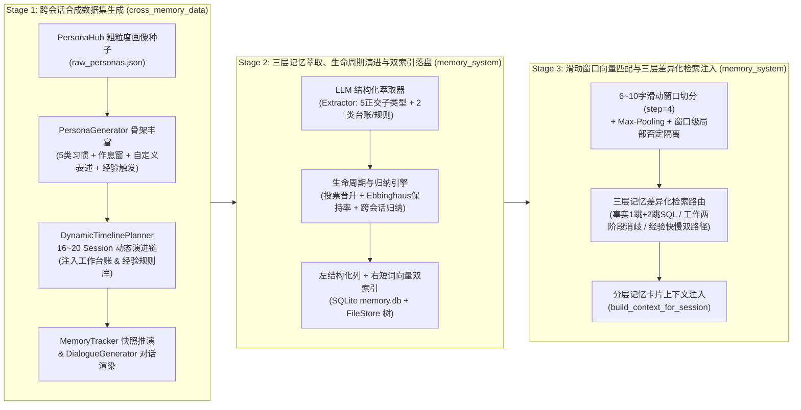
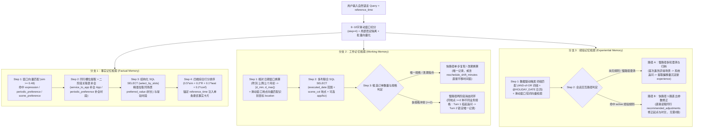

# 跨会话记忆数据集生成、记忆萃取与检索注入全景架构 (`COGNITIVE_MEMORY_ARCHITECTURE.md`)

> **文档定位**：本文件为全局跨项目（`cross_memory_data` × `memory_system`）的系统级架构规范与真实样本举例参考。所有算法描述与汇报严格遵循全局术语规范（严禁使用“吸附”、“跳板行”、“解锁”、“黑话”、“结晶”、“对账”等非标词汇）。

---

## 一、全链路三阶段总览

系统由两大核心工程仓闭环衔接，分为三个阶段：

---

## 二、模块一：跨会话记忆数据集生成全链路 (`cross_memory_data`)

### 2.1 四步分层生成流水线

1. **Step 1：PersonaHub 初始种子采样与多维记忆骨架生成 (`raw_personas.json` $\rightarrow$ `persona_skeleton.json`)**
   - **初始输入**：从开源数据集 `proj-persona/PersonaHub` 采样约 200 字的自然语言粗粒度人物描述（如：`user_001 林辰，28岁独立户外极限运动摄影师，常驻川西与崇礼，高频使用抖音直播、B站发片、百度网盘传素材`）。
   - **多维结构化扩充 (`PersonaGenerator`)**：基于粗粒度种子扩充出具备严格业务逻辑自洽性的 JSON 骨架：
     - **5 类核心业务习惯 (`core_habits`)**：覆盖 App、常用地点、默认时长（`30~240min` 多分布）、服务类型、频率与典型固定时段，严格校验 `end - start == duration`。
     - **3~4 个周期性时间窗 (`schedule_windows`)**：绑定具体习惯 ID、固定起止时间与高频星期列表。
     - **3~5 组用户自定义表述映射 (`expression_dict`)**：口语代称/简称 $\rightarrow$ 真实业务实体或时间窗。
     - **2~3 条异常/节假日动态调整规则 (`experience_triggers`)**：触发场景 + 修正逻辑（如时间提前 `30` 分钟、时长延长 `30` 分钟）。
2. **Step 2：16~20 Session 动态时间线编排与三层事件注入 (`DynamicTimelinePlanner`)**
   - 在数月跨度（如 `2026-06` 至 `2026-08`）内编排 `16~20` 个连续会话，交织注入三层记忆演进事件：
     - **事实记忆阶段演进**：初探期（`S01~S05`，建立映射与习惯）$\rightarrow$ 稳定期（`S06~S10`，复现巩固）$\rightarrow$ 临时变异期（`S11~S13`，单次地点/时长变更，测试抗污染隔离）$\rightarrow$ 习惯迁移期（`S14~S16`，连续 $\ge 2$ 次新规律触发永久晋升）。
     - **工作记忆生成 (`working_records.json`)**：生成 `6~8` 条历史已执行订单台账，包含刻意设计的**同地点多规格冲突对**（测试两阶段消歧）与**改期操作样本**（如“推迟半小时”）。
     - **经验记忆生成 (`experience_bank.json`)**：先安排慢路径多轮澄清归纳会话（`crystallize_experience`），间隔若干会话后安排快路径直接复用会话（`apply_experience`）。
3. **Step 3：状态机推演与标准记忆状态快照生成 (`MemoryTracker`)**
   - 沿时间线逐会话推演，在每个 Session 开始前输出当前时刻的**标准记忆状态快照（Ground-Truth Memory Snapshot）**，精确记录每条记忆的 `status`、`positive_votes` 与当前生效槽位值。
4. **Step 4：受控多轮对话渲染与双轨验证 (`DialogueGenerator` + `QualityValidator`)**
   - 根据每个 Session 的隐式测试模式（如 `implicit_alias_and_window`、`working_memory_multi_turn_clarify`、`experience_fast_apply`），调用 `deepseek-v4.1-flash` 渲染自然多轮对话，并通过正则零泄漏检查与 LLM 逻辑自洽性校验。

---

## 三、模块二：三层记忆萃取、生命周期演进算法与双索引存储 (`memory_system`)

系统在架构上按**生命周期演进特性**对三层记忆实施差异化设计：**事实记忆**具备完整的动态投票晋升、Ebbinghaus 遗忘衰减、热度半衰期与跨会话归纳机制；**工作记忆**与**经验记忆**则采用确定性静态台账/规则存储（零衰减、无跨会话合并）。

### 3.1 事实记忆 (`factual_memory`)：五类正交萃取与动态生命周期算法

#### (1) 方案 A 五类正交原子事实子类型
单次会话若有 $N$ 个预约意图，先按意图切分为 $N$ 个独立事件块，分别萃取以下 5 类正交记录（严禁跨子类型混装槽位）：
1. **`preferred_value`（服务时长偏好）**：写 `app_col + biz_col + scene_col`，Payload 仅存 `preferred_duration`（如 `"180分钟"`）；`phrase_text` 为 `"{app} {service}"`（严禁混入地点词）。
2. **`scene_preference`（场景常驻偏好）**：写 `app_col + biz_col + scene_col`，Payload 存 `typical_Action_time`；`phrase_text` 为纯地点词 `"{location}"`（`4~10` 字）。
3. **`service_to_app`（业务归属映射）**：写 `biz_col + app_col`，绑定无主业务词与默认宿主 App；`phrase_text` 为纯业务词 `"{service}"`。
4. **`periodic_preference`（周期时间窗偏好）**：写 `time_window_col + app_col + biz_col + scene_col`，记录固定时段与业务绑定；`phrase_text` 为口语时段词 `"{window_label}"`（如 `"中午例行档期"`）。
5. **`expression`（用户自定义表述映射）**：写 `alias_col + target_col`，记录口语代称到标准实体的映射；`phrase_text` 为纯代称 `"{alias}"`（如 `"开直播保障"`）。

#### (2) 显式/隐式投票晋升状态机 (`MemoryUpdater._apply_vote_and_promote`)
- **状态流转**：`candidate`（初筛候选，`vote=1, conf=0.60`）$\rightarrow$ `active`（生效事实，`vote=2, conf=0.80`）$\rightarrow$ `reinforced`（稳固偏好，`vote>=3, conf=0.92`）；冲突观察进入 `disputed`（争议观察），被新习惯替代后转入 `archived`（归档留存）。
- **显式声明直通 (`is_explicit_statement = true`)**：若用户在对话中明确声明长期规则（如 `“记一下，以后我一说‘开直播保障’就是指开游戏加速”`），无需等待第 2 次复现，首次提取即赋予 `positive_votes = 2`，直接跳过 `candidate` 晋升为 **`active`**（对于 `expression` 映射额外赋予 `positive_votes = 3, confidence = 0.95`）。
- **常规隐式复现晋升**：普通日常对话中首次提取为 `candidate (vote=1)`；跨会话第 2 次观测到相同 `(category, key, value)` 时累加 `positive_votes = 2` 并晋升为 `active`；第 3 次起晋升为 `reinforced`。
- **同会话去重保护 (`last_voted_session`)**：同一 Session 内多次提及同一偏好仅计 1 票，必须跨 Session 复现才触发晋升，防止单次长对话刷票。

#### (3) Ebbinghaus 间隔重复保持率与热度半衰期模型 (`MemoryRecord`)
每条事实记忆维护独立的记忆强度 $S(n)$、时间保持率 $R(t,n)$ 与访问热度 $\text{heat}_{\text{eff}}$：
- **有效复习次数**：
  $$n = \max(0, \text{positive\_votes} - 1) + \text{reuse\_count}$$
- **记忆强度增强因子**（默认 $\kappa = 0.8$）：
  $$S(n) = 1.0 + \kappa \cdot \ln(1 + n)$$
- **Ebbinghaus 指数衰减保持率**（事实记忆默认基础衰减率 $\lambda = 0.03\text{ d}^{-1}$）：
  $$R(t, n) = \exp\left(-\frac{\lambda}{S(n)} \cdot \Delta\text{days}\right)$$
- **7 天半衰期访问热度**（每次被检索命中复用时触发 `record_access()`，`reuse_count += 1` 且热度瞬时提升 `+0.05`，上限 `1.0`）：
  $$\text{heat}_{\text{eff}} = \text{heat} \times 0.5^{\Delta\text{hours} / 168}$$

#### (4) 临时变异抗污染防御与偏好迁移裁决 (`_find_conflicting_records`)
- **单次临时变更拦截 (`_TEMP_VETO_WORDS`)**：当萃取器检测到 `“今天临时 / 这次先 / 破例 / 改在”` 等单次临时修饰词（标记 `is_temporary_override = true`）且与已有 `active/reinforced` 事实冲突时，系统将其作为单次独立 `candidate (vote=1)` 隔离旁路，**严禁削减原稳固事实的置信度或篡改其槽位**。
- **真实习惯迁移晋升**：若新参数在后续会话中持续复现（累计达到 $\ge 2$ 票且超过旧事实有效权重），新记录晋升为 `active (conf=0.82)`，同时原冲突记录自动降级为 `archived (conf=0.35)` 并写入 `superseded_by` 溯源指针。

#### (5) 跨会话确定性归纳引擎 (`InductionEngine.induce`)
除 LLM 直接萃取外，每轮落盘后由确定性统计归纳器扫描用户全量记录，自动合成隐式关联规律：
1. **业务归属自动归纳 (`_induce_service_to_app`)**：扫描 `preferred_value` 与 `scene_preference`，若某 `service` 在 $\ge 2$ 个独立证据中稳定指向唯一 `app`，自动合成或升级 `service_to_app (active)`。
2. **周期时间窗自动归纳 (`_induce_periodic_preferences`)**：将历史时间按 5 大标准时段（清晨/上午/中午/下午/晚上）聚类，若同一 `(时段, app, service)` 在不同会话中重复出现 $\ge 2$ 次，自动提炼或强化 `periodic_preference` 记录。

---

### 3.2 工作记忆与经验记忆的萃取与静态存储机制

| 维度 | 工作记忆 (`working_memory` / `working_record`) | 经验记忆 (`experiential_memory` / `experience`) |
| :--- | :--- | :--- |
| **提取触发条件** | 会话中达成明确执行共识的**常规预约订单**（显式过滤掉含 `is_temporary_override` 的单次临时改主意记录） | 会话中发生**慢路径多轮澄清或用户主动纠偏**（如用户指出恶劣天气/节假日需提前开启并延长时长） |
| **混合提取算法** | LLM 提取完整 7 槽位已执行台账（含 `executed_date`、`date_ bucket`、`location`、`app`、`service`、`duration`、`start_time~end_time`） | LLM 提取结构化规则 + **正则动态偏移量校准**（自动解析对话中的 `提前X分钟 -> -Xmin`、`多开Y分钟 -> +Ymin`，构建 `recommended_adjustments`） |
| **生命周期属性** | **静态订单台账**：落地即 `active (vote=1, conf=0.85)`，衰减率 $\lambda = 0.0$（永不随时间衰减），每笔订单分配独立时间戳 Key，不跨会话覆盖 | **长效自适应规则卡**：一经归纳即 `active (vote=2, conf=0.90)`，衰减率 $\lambda = 0.0$；支持同场景规则增量合并 `trigger_keywords` |
| **向量化索引策略** | 仅对纯地点短词 `"{location}"` 编码 `1024` 维向量（若地点为空则退化为 `"{app} {service}"`） | 将触发条件与场景拼接为自然语言短词（如 `"暴雨天气 雪场封道 提前开启"`）编码 `1024` 维向量 |

---

### 3.3 单库双索引表 (`index/memory.db`) 与 `FileStore` 目录树

系统采用 **SQLite 单库双索引表 + 本地 Markdown/JSON 文件树** 的混合持久化架构：

1. **左结构化槽位列 + 右高纯度短词向量 (`index/memory.db`)**：
   - **左半区（结构化槽位过滤列）**：`app_col`、`biz_col`、`scene_col`、`time_window_col`、`alias_col`、`target_col`、`executed_date`、`status`。支持微秒级 SQL 精确等值/范围过滤（`SELECT ... WHERE app_col=? AND biz_col=?`）。
   - **右半区（高纯度短词向量列）**：`phrase_text`（严格限制为 **4~10 字无噪声核心短词**）+ `embedding`（`text-embedding-v4`，`1024` 维 `float32` 向量）。
2. **`FileStore` 物理目录树 (`data/memory_Spaces/<user_id>/`)**：
   - `USER.md`（画像总览）+ `factual_memory/`（按 5 子类型分 Markdown 文件）+ `working_memory/working_record.md` + `experiential_memory/experience.md` + `sessions/`（原始对话归档）+ `index/memory.db`。

---

## 四、模块三：滑动窗口向量匹配与三层记忆差异化检索注入 (`memory_system`)

### 4.1 统一短词向量池与 6~10 字滑动窗口向量匹配算法 (`MemorySearch.retrieve`)

针对自然语言长 Query 直接编码会导致局部关键短词（如地点、代称、时段词）语义被稀释的问题，检索层设计了**滑动窗口切分 + Max-Pooling 聚合 + 窗口级局部否定隔离**算法：

1. **短词级向量池构建**：库内所有记忆的 `phrase_text` 均为 `4~10` 字高纯度短词（如 `"崇礼云顶滑雪基地"`、`"开直播保障"`、`"中午例行档期"`）。
2. **Query 滑动窗口切分 (`_extract_query_clauses`)**：
   - 先按标点与转折连词切分子句；对长度 $> 8$ 字的子句，以 **窗口长度 $L=8$ 字、步长 $\text{step}=4$ 字** 生成重叠滑动窗口（外加首尾 `6` 字短窗），将长句拆解为一组 `6~10` 字局部语义片段 $\{w_1, w_2, \dots, w_k\}$。
3. **窗口级局部否定隔离 (`_NEGATION_PATTERNS`)**：
   - 对每个窗口/子句独立检测否定前缀（如 `“不去 / 别在 / 取消 / 改在...之前”`）。若窗口 $w_j$ 命中否定模式（如 `“今天我不去滑雪基地了”`），其内部实体词被归入负向抑制集 $W_{\text{neg}}$，**严禁进入正向向量检索池**；若候选记录同时匹配负向窗口且未被后续正向窗口覆盖，直接施加 **`-0.35` 否定惩罚分**并剔除。
4. **批量 Embedding 与跨窗口 Max-Pooling 相似度**：
   - 将所有正向窗口 $\{w_j^+\}$ 在单次 API 请求中批量编码为 `1024` 维向量 $\{\mathbf{v}(w_j^+)\}$，与库内记忆短词向量 $\mathbf{e}_i$ 计算余弦相似度矩阵，取跨窗口最大值作为该记录的最终向量得分：
     $$\text{sim}(\text{Query}, r_i) = \max_{w_j^+ \in W_{\text{pos}}} \cos\big(\mathbf{v}(w_j^+),\, \mathbf{e}_i\big)$$

---

### 4.2 三层记忆差异化检索与上下文注入方案

在统一的短词向量池之上，三层记忆根据各自的业务语义执行**完全差异化的检索路由与交互闭环策略**：

#### (1) 事实记忆检索方案：窗口向量召回 $\rightarrow$ 同行槽位提取 $\rightarrow$ 二阶段关联补全 $\rightarrow$ 结构化 `SELECT`
1. **一阶段窗口向量召回与同行槽位提取**：用正向滑动窗口向量匹配 `expression`（阈值 `0.65`）、`periodic_preference`（阈值 `0.55`）与 `scene_preference`（阈值 `0.48`），直接读取命中记录的同行结构化列（如命中 `"中午例行档期"` 即读取同行 `time_window_col="12:30~15:30", biz_col="游戏加速", scene_col="崇礼云顶滑雪基地"`）。
2. **二阶段关联表补全（2-Hop Relational Completion）**：
   - 若已解析出 `biz_col` 但缺失 `app_col`，自动查询 `service_to_app` 表补全宿主 App（如 `"游戏加速" -> "抖音"`）。
   - 若已解析出 `(app_col, biz_col)` 但缺失显式时间窗，反查 `periodic_preference` 表补全常驻时段。
3. **结构化槽位精准查询 (`select_by_slots`)**：携带对齐后的 `(app_col, biz_col, scene_col)` 执行 SQL 联合过滤，精准拉取该场景下的 `preferred_value`（默认时长）与 `scene_preference`（常驻时段）。
4. **四维综合评分与单条最优注入**：按综合得分排序，仅保留每个子类型的 Top-1 最优事实，结合会话 `reference_time` 换算为绝对时间窗后注入上下文：
   $$\text{Score}(r_i) = 0.50 \cdot \text{sim} + 0.20 \cdot R(t, n) + 0.10 \cdot \text{heat}_{\text{eff}} + 0.20 \cdot \text{confidence}$$

#### (2) 工作记忆检索方案：相对日期窗口换算 + 多列联合 `SELECT` + 两阶段消歧闭环 (`working_rules.py`)
1. **相对时间锚点解析 (`resolve_relative_date_window`)**：基于会话基准时间 `reference_time`，将口语时间词换算为精确的 `executed_date` 闭区间：
   - `"昨天 / 前天 / 大前天"` $\rightarrow \Delta \in [1, 3]$ 天；`"上周"` $\rightarrow \Delta \in [5, 10]$ 天；`"上上周 / 半个月前"` $\rightarrow \Delta \in [11, 20]$ 天；`"上个月初"` $\rightarrow$ 上月 `01~10` 日（复杂表述自动回退 LLM 时间解析器）。
2. **多列联合过滤**：结合日期区间 `[date_min, date_max]`、滑动窗口向量匹配识别出的目标地点 `location`（如 `"酒店房间"`）以及可选的 `app/service` 过滤历史订单台账。
3. **快路径复现/改期 vs. 慢路径两阶段消歧**：
   - **唯一命中或改期指令 (`reschedule_shift_minutes`)**：若过滤后仅剩唯一规格，或用户发出改期指令（如 `“把昨天预约的那单往后推迟半小时”`），系统直接读取原单起止时间并平移 `+30min`，单步完成注入。
   - **同地点多规格冲突消歧（Two-Stage Disambiguation）**：若同一地点/日期范围内命中 $\ge 2$ 条不同业务规格的历史订单（例如上周在 `"酒店房间"` 既开过 `"抖音-游戏加速-180分钟"`，又开过 `"百度网盘-极速上传-120分钟"`），且首轮 Query 未指明具体业务：
     - **Turn 1（挂起与反问）**：系统不盲目猜测，将全部冲突候选注入 `[工作记忆候选（需向用户澄清确认）]`，驱动助手主动列出两个历史选项询问用户；
     - **Turn 2（锁定与闭环）**：根据用户次轮回复中的业务/时长关键词二次过滤，锁定唯一目标订单完成参数复现。

#### (3) 经验记忆检索方案：数据驱动触发词组匹配 + 快慢双路径自适应修正 (`experience_rules.py`)
1. **混合触发匹配 (`match_experiences_from_records`)**：
   - **向量路**：滑动窗口向量匹配 `experience` 短词向量；
   - **规则路（AND-of-OR 触发词组）**：从库内已激活的 `experience` 记录动态加载 `trigger_keywords`（分为天气/网络异常组、场景组、法定节假日日历组 `@HOLIDAY_DATE`），当 Query 同时命中所需的条件词组（或 `reference_time` 落在法定节假日表内）时立即触发。
2. **路径 A（慢路径多轮澄清与规则沉淀）**：当首次遇到异常场景、库内尚无对应 `active` 经验时，通过多轮交互引导用户确认调整幅度，会话结束后由萃取器的正则偏移量解析器沉淀为长期生效的 `experience` 规则卡。
3. **路径 B（快路径 1 跳直出参数修正）**：当后续会话再次命中已生效的 `experience` 记录时，**无需执行 2 跳关联查询**，直接读取同行 Payload 中的 `recommended_adjustments`（如 `start_time_offset: "-30min"`, `duration_offset: "+30min"`），在事实记忆基准时间窗（如 `19:00~21:00, 120分钟`）上原地叠加修正，直出调整后的目标参数（`18:30~21:00, 150分钟`）。

---

## 五、真实样本举例 (`user_001` 林辰)

以下展示同一用户从种子生成、三层记忆落盘到滑动窗口检索注入的真实数据流转：

1. **输入测试 Query**（Session 12，`reference_time = "2026-07-15 11:00"`）：
   > `“今天我不去滑雪基地了，改在酒店房间里，趁着中午那个例行档期，把抖音开直播保障开上。”`
2. **Step 1：6~10 字滑动窗口切分与窗口级局部否定隔离**：
   - 子句 1 `“今天我不去滑雪基地了”` $\rightarrow$ 命中 `_NEGATION_PATTERNS`（`不去`），提取负向实体 `W_neg = {"滑雪基地"}`，予以隔离拦截（后续若召回含 `"滑雪基地"` 的记录直接扣减 `-0.35`）。
   - 子句 2~4 切分为正向滑动窗口：`w1 = "改在酒店房间里"`、`w2 = "趁着中午那个例行"`、`w3 = "那个例行档期"`、`w4 = "把抖音开直播保障"`、`w5 = "开直播保障开上"`。
3. **Step 2：窗口向量检索与同行槽位提取**：
   - 窗口 `w1 ("改在酒店房间里")` 命中 `scene_preference` 短词 `"酒店房间"`（$\text{sim}=0.86$）$\rightarrow$ 锁定当前生效地点 `scene_col = "酒店房间"`（覆盖原默认滑雪基地）。
   - 窗口 `w3 ("那个例行档期")` 命中 `periodic_preference` 短词 `"中午例行档期"`（$\text{sim}=0.91$）$\rightarrow$ 读取同行结构化列：`time_window_col = "12:30~15:30"`、`biz_col = "游戏加速"`。
   - 窗口 `w5 ("开直播保障开上")` 命中 `expression` 短词 `"开直播保障"`（$\text{sim}=0.94$）$\rightarrow$ 读取同行 `target_col = "游戏加速"`（交叉验证业务类型）。
4. **Step 3：二阶段关联补全与结构化 `SELECT`**：
   - 携带 `(app_col="抖音", biz_col="游戏加速", scene_col="酒店房间")` 执行 `select_by_slots`，命中 `"酒店房间"` 场景下的 `preferred_value` 记录，读取 `preferred_duration = "180分钟"`。
5. **Step 4：注入上下文卡片并生成最终预约参数**：
   - 结合 `reference_time (2026-07-15)` 与各槽位，输出完整上下文注入卡片，驱动助手零追问直接生成预约确认：`App=抖音, Service=游戏加速, Location=酒店房间, Duration=180分钟, Time=2026-07-15 12:30~2026-07-15 15:30`。
