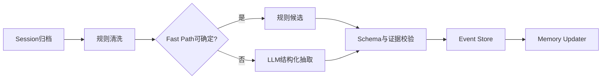
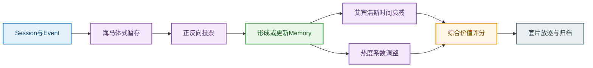

# 记忆建模

## 记忆的存储表达结构和拓扑

几种表达的优缺点：

| 单一表示 | 优点 | 主要问题 |
| :--- | :--- | :--- |
| 纯文本 | 表达能力强，适合 LLM 阅读 | 难以精确过滤、更新、判断有效期和并发控制 |
| 纯 JSON / 关系表 | 可校验、可查询、可审计 | 复杂条件、例外、原因和案例语义表达不足 |
| 纯向量 | 语义召回方便 | 不是权威事实存储，不能可靠处理冲突、替代和时间有效性 |
| 纯知识图谱 | 适合关系遍历 | 原子事实、长文本和频繁更新的工程成本较高 |
| 纯目录树 | 便于组织和分层加载 | 不能单独表达证据、冲突和版本演化 |

采用四层组合的方式对记忆进行存储：

1. **结构化节点表达状态**：保存类型、Scope、有效期、状态、证据、版本；
2. **Markdown 是语义正文**：保存完整含义、条件、例外、原因和可读说明；具体正文格式需要与现有数据结构和下游使用方式保持一致；
3. **OpenViking 的目录树作为上下文组织骨架**：负责 User/Agent 隔离、类型分区和 L0/L1/L2 加载；
4. **有限关系边作为演化和追溯层**：只表达证据、强化、冲突、替代、摘要和经验归纳关系。

向量、关键词和图索引均为派生索引，可以重建，不能作为权威状态。

| 一些问题 | 对应设计 |
| :--- | :--- |
| 精确判断“这条记忆现在是否有效” | 使用 `status` 标记当前状态，使用 `validity` 记录生效时间、失效时间和有效条件 |
| 避免不同用户、APP 和场景混写 | 使用 `user_id`、APP 和业务标识区分记忆归属，并通过 `scope` 限定记忆适用的 APP、业务和场景 |
| 保存复杂条件和例外 | 关键条件使用结构化字段保存，难以结构化的补充条件和例外写入 Markdown 正文 |
| 按用户、类型、主题分层加载 | 使用 OpenViking 目录树，按照用户、记忆类型和业务主题分目录组织与加载 |
| 回答“为什么得出这个结论” | 保留原始 Event 证据，并通过 `supports`、`derived_from` 边关联证据与记忆结论 |
| 保留用户偏好变化历史 | 偏好变化时创建新版 Memory，通过 `supersedes` 边连接新旧版本，不直接覆盖旧记录 |
| 多跳记忆检索（需要沿着记忆之间的关系继续查找信息） | 建立少量必要的 Memory—Event、Memory—Memory 图关系，并结合关键词索引查找关联信息 |
| 避免图无限膨胀 | 预先限定允许创建的节点类型和关系类型，不允许模型任意扩展图结构 |

检索采用“结构化过滤 + 语义召回 + 关系追溯”的组合方式：

1. **时间相关检索**：先将“上周、最近几次、去年夏天”等自然语言时间转换为标准时间范围，再根据 Event 时间戳进行确定性过滤；
2. **用户偏好检索**：先按 `user_id`、记忆类型、APP、业务、场景和有效状态缩小范围，再进行 Dense/Sparse 语义召回；
3. **案例与经验检索**：根据当前意图类型和槽位状态召回相似 Case、动作模式或 Policy，重点覆盖历史易错点、被用户驳回后的处理方式以及成功闭环路径；
4. **证据追溯**：命中 Memory 后，通过 `derived_from`、`supports` 等关系继续定位 Event、Session 和 Turn，回答结论来源；
5. **向量持久化**：OpenViking 将完整正文、L0 摘要、L1 概览和 L2 详情保存在 AGFS 中，将 Embedding、URI 和检索元数据保存在 Vector Index 中。向量索引只用于召回，可以重建，不作为 Memory 权威状态。

### 目录拓扑

```text
viking://user/{user_id}/
├── profile.md
├── memories/
│   ├── preferences/
│   │   ├── expression/
│   │   │   └── {memory_id}/
│   │   │       ├── memory.md
│   │   │       └── evidence.json
│   │   ├── application_business/
│   │   ├── experience_parameter/
│   │   ├── time_pattern/
│   │   └── environment/
│   ├── events/YYYY/MM/
│   │   └── YYYYMMDD_HHMMSS_{event_id}.json
│   └── timelines/
│       ├── preference/
│       └── environment/
└── sessions/{session_id}/history/

viking://agent/{agent_id}/
└── memories/
    ├── cases/
    ├── trajectories/
    └── policies/
```

各目录职责如下：

| 目录 | 保存内容 | 主要作用 |
| :--- | :--- | :--- |
| `sessions/{session_id}/history/` | 未经抽象的原始会话、工具调用和结果 | 保留最完整的审计来源 |
| `events/YYYY/MM/` | 从 Session 抽取的带时间戳原子 Event | 保存“何时发生了什么”，并关联来源 Session 和 Turn |
| `preferences/` | 用户当前有效的表达映射、应用—业务选择和条件偏好 | 支持意图理解和槽位补全 |
| `evidence.json` | Memory 引用的 Event、Session、Turn 和证据类型 | 回答“为什么形成这条 Memory” |
| `timelines/` | 多个 Event 经 TIME_COMPRESS 形成的主题时间线摘要 | 保留偏好的形成、强化、例外和变化过程 |
| `cases/` | 删除干扰信息后保留的一次难例关键处理过程 | 复用相似初始状态下的处理经验 |
| `trajectories/` | 从多个相似 Case 进一步抽象出的动作模式 | 描述一类问题通常按什么动作序列处理 |
| `policies/` | 经多个 Case 或动作模式验证后的稳定策略 | 指导 Agent 在满足适用条件时选择动作 |

Event 不是“每个槽位单独生成一个”。一次原子用户表达生成一个 Event，并通过 `target_slots` 标记它能够支持哪些槽位，同时保留来源 Session 和 Turn。例如：

```json
{
  "event_id": "EVENT_E1",
  "event_time": "2026-08-25T09:00:00Z",
  "event_type": "expression_mapping_confirmation",
  "source_session_id": "SESSION_S1",
  "evidence_turns": [1, 2, 3],
  "target_slots": ["application", "business", "scene"],
  "content": {
    "source_expression": "开播保障",
    "application": "douyin",
    "business": "live",
    "scene": "outdoor_live"
  }
}
```

同一个 Event 可以同时支持 `application`、`business` 和 `scene`，无需为了三个槽位复制三份 Event。

### User 与 Agent 目录区分示例

历史会话中，用户明确表示：

```text
以后我说“开播保障”，就是抖音户外直播。默认1080P并优先稳定，网络不好时可以降到720P。
```

当前会话中用户只说：

```text
今晚在景区给我开播保障。
```

User 空间保存这个用户的具体信息：

```text
preferences/expression/
→ “开播保障”表示抖音户外直播

preferences/experience_parameter/
→ 默认1080P、稳定优先，弱网时允许降到720P

events/
→ 用户在哪个Session、哪些Turn中声明并确认了这些内容

timelines/
→ 上述偏好何时形成、何时强化、是否出现过临时例外或纠错
```

Agent 空间不保存 U001 的具体偏好，而保存处理此类低确定性请求的经验：

```text
cases/
→ 某次请求缺少APP和体验参数，Agent通过同Scope User Memory完成补全，合并为一次确认后成功闭环

trajectories/
→ 识别个性化表达 → 召回同Scope偏好 → 检查冲突 → 合并缺失槽位 → 一次确认

policies/
→ 当多个缺失槽位可由同一Scope下的Active Memory唯一补全，且不存在冲突时，优先合并为一次确认；若Scope不一致或存在冲突，则进入消歧
```

因此：

```text
User Memory：这个用户偏好什么
Event：这个用户在何时明确说过或确认过什么
Timeline：用户偏好如何形成和变化
Case：一次难例中什么处理流程成功或失败
Trajectory：多个相似Case呈现出的动作模式
Policy：经验证后可稳定执行的策略
```

User 空间只保存“关于特定用户的事实和偏好”；Agent 空间保存“遇到某类状态应采取什么动作”。二者不能混存。

用户提供的信息和 Agent 自己生成、推测或执行的信息分开管理，避免混淆来源。

### 核心节点与关系

核心节点：

| 节点 | 保存内容 | 是否表示当前状态 |
| :--- | :--- | :--- |
| `Event` | 带时间戳的原始证据 | 否 |
| `Memory` | 用户当前有效事实或偏好 | 是 |
| `TimelineSummary` | 某主题一段时间的演化摘要 | 是历史概括 |
| `Case` | 状态—动作—结果轨迹 | 否 |
| `Trajectory` | 从多个相似 Case 抽象出的动作模式 | 是 Agent 侧中间经验 |
| `Policy` | 从多个 Case 归纳的策略 | 是 Agent 侧经验 |

核心关系：

| 关系 | 起点 → 终点 | 作用 |
| :--- | :--- | :--- |
| `derived_from` | Memory → Event | 指明记忆来源 |
| `supports` | Event → Memory | 新证据支持当前结论 |
| `reinforces` | Event → Memory | 重复证据强化记忆 |
| `contradicts` | Event → Memory | 新证据与当前状态冲突 |
| `supersedes` | 新 Memory → 旧 Memory | 新长期状态替代旧状态 |
| `summarized_into` | Event → TimelineSummary | 底层 Event 已被摘要覆盖 |
| `abstracted_into` | Case → Trajectory | 多个相似 Case 形成动作模式 |
| `derived_from_case` | Policy → Case | 策略由哪些案例归纳 |
| `derived_from_trajectory` | Policy → Trajectory | 策略参考了哪些动作模式 |
| `uses` | Case → Policy | 案例执行时采用了什么策略 |

`evidence` 字段和关系边职责不同：

- `evidence: [E1, E3]` 用于快速取得证据集合；
- `E3 --reinforces--> M1` 精确说明 E3 对 M1 产生了什么作用；
- `M2 --supersedes--> M1` 表达的是状态演化，不是普通证据引用。

```json
{
  "memory_id": "MEM_PREF_001",
  "memory_type": "preference",
  "memory_subtype": "experience_parameter",
  "owner": {
    "owner_type": "user",
    "owner_id": "U001"
  },
  "scope": {
    "application": "douyin",
    "business": "live",
    "scene": "outdoor_live",
    "environment": null
  },
  "content": {
    "resolution": "1080P",
    "priority": "stability"
  },
  "description": "用户户外使用抖音直播时默认采用1080P，并优先保证稳定性。",
  "validity": {
    "type": "long_term",
    "valid_from": "2026-05-12T00:00:00Z",
    "valid_to": null
  },
  "evidence": ["EVENT_E1", "EVENT_E3"],
  "confidence": 0.95,
  "status": "reinforced",
  "version": 2,
  "created_at": "2026-05-12T00:00:00Z",
  "updated_at": "2026-06-02T00:00:00Z"
}
```

Embedding 只判断“语义是否相似”，不能判断“是不是同一份状态”。更新记忆目标必须由记忆字段组合决定：

| 记忆类型 | 记忆字段组合 | 职责与单一权威真相（Single Source of Truth，正交无冗余方案 A） |
| :--- | :--- | :--- |
| **1. 应用↔业务默认路由 (`service_to_app`)** | `user_id + business` *(SQLite 双向索引 `app_col, biz_col`)* | **应用与业务默认路由层**：专门保存 `business <-> application` 的默认绑定关系（用于“只提业务补应用”或“只提应用补业务”），**不存储**画质/时延参数、周期时段或场景；消除了与参数层主键重合的冗余空壳 `application_business` |
| **2. 周期时间路由指针 (`periodic_preference`)** | `user_id + condition(time_window) + value(app:biz)` | **轻量时间路由指针层**：只管时间段到业务的映射 `time_window -> application:business`，**绝不存储** `resolution`、`latency` 等具体 QoS 参数 |
| **3. 默认参数偏好 (`preferred_value`)** | `user_id + application + business` | **通用 QoS 参数唯一权威真相**：只管该 `(application, business)` 下的标准体验参数（`resolution`、`latency`、`priority`），**绝不存储** `time_window` 周期时段或 `scene` 场景 |
| **4. 场景参数覆写 (`scene_preference`)** | `user_id + scene + application + business` | **特定场景参数覆写层**：只管特定物理/任务场景（如“外勤保障现场”、“大巴转场途中”）下的体验参数覆写（`resolution`、`latency`），**绝不存储**周期时段 `time_window` |
| **5. 个性化黑话词典 (`expression`)** | `user_id + alias` *(含轻量适用 `scope: app/biz/scene`)* | **口语黑话词典层**：只管用户口语代称到标准槽位值的翻译（如 `午间例行 -> 12:30-13:30`、`保个基本画质 -> 720p`），检索时用于先验展开，**不存储**母记忆参数快照或时间段 |
| **6. 环境偏好 (`environment`)** | `user_id + environment + application + business` | **无线网络环境退让层**：只管在弱网、移动、拥塞等特殊无线环境下的参数退让策略 |
| **Case** | `intent_category + initial_state_signature + solution_signature` | Agent 侧单次难例完整状态—动作—结果轨迹 |
| **Policy** | `intent_category + applicable_state_signature` | Agent 侧经多个 Case 验证的稳定执行策略 |

### 检索的「黑话展开 + 指针两跳路由 + 正交槽位 `SELECT` 拼装 + 语义混合重排」架构

既然五类用户记忆按职责正交解耦存储（时间归 `periodic_preference`、参数归 `preferred_value` / `scene_preference`、应用业务路由归 `service_to_app`、黑话归 `expression`），检索时通过**三步结构化与语义协同检索**将正交节点无损拼装还原：

1. **Step 1：Query 黑话先验展开与槽位关键词挖掘（Zero-LLM）**
   - 扫描用户当前有效的 `expression` 词典（带作用域守卫）：若 Query 命中 `alias`（如“按**午间例行**的时间给**阿抖**开保障”），立即将对应的 `target`（`12:30-13:30`、`抖音`）注入查询槽位解析器；
   - 基于 `app_map`、业务词表、场景词表与时间正则（含参考时间提前 30 分钟预热窗口），从 `Query + 展开后文本` 中提取结构化查询槽位：`applications`、`businesses`、`scenes`、`time_windows`。
2. **Step 2：指针两跳路由与 SQLite 正交结构化字段 `SELECT`**
   - **时间指针跳（Time-Pointer Hop）**：若提取到时间窗（或由会话参考时间预热匹配），查询 `periodic_preference` (`12:30-13:30 -> douyin:live`)，自动解析出目标 `application="douyin", business="live"`；反之若已知 `(application, business)`，同样关联合中对应的 `periodic_preference` 获取例行时段；
   - **应用↔业务指针跳（Service-App Hop）**：若 Query 仅提供了业务名（如“按老规矩开直播”）或仅提供了应用名，查询 `service_to_app` (`live <-> douyin`) 自动双向补全缺失的 `application` 或 `business`；
   - **正交参数层 `SELECT`**：根据解析出的 `(application, business, scene, time_window)` 在 SQLite 二级索引列上执行 `SELECT`：
     - 若存在特定 `scene`，命中 `scene_preference[scene | app | biz]` 获取场景覆写参数（`resolution`, `latency`）；
     - 若为常规场景，命中 `preferred_value[app | biz]` 获取默认参数偏好（`resolution`, `latency`）；
     - 同时命中 `periodic_preference[time_window | app:biz]` 获取时间段，在桥接层将“参数节点 + 时间路由节点”正交组合为完整意图槽位。
3. **Step 3：结构化确定性分 + Vector/FTS5 语义分 + 艾宾浩斯动态稳定性重排**
   - 结构化槽位精确命中的节点赋予高确定性相关性基准分，再与向量余弦相似度、FTS5 关键词分、艾宾浩斯动态保留率 $R(t, n)$ 及热度 $H(m)$ 加权融合。

---

## 哪些内容需要记忆？记忆分层时的时间窗口阈值应该如何设置？

只保存未来可能改变意图理解、槽位补全、追问决策或任务执行的内容，分为四类长期记忆和两类证据对象：

| 对象 | 核心问题 | 存储空间 |
| :--- | :--- | :--- |
| 场景化用户偏好 | 用户在特定 APP、业务、场景下偏好什么 | User |
| 环境偏好 | 特定移动网络环境下用户倾向怎样取舍 | User |
| Case 经验 | 某种意图状态下什么交互轨迹成功或失败 | Agent |
| Policy 策略 | 某类状态应执行什么动作 | Agent |
| Event | 结论来自哪些历史交互 | User / 证据层 |
| Session Archive | 保留可追溯的原始会话 | Session 层 |

- **场景**：用户正在做什么。
- **环境**：用户是在什么网络条件下做。

### 场景化用户偏好

需要保存：

- 个性化表达映射；
- 默认 APP 或业务选择；
- 体验参数组合，如低时延、稳定性、分辨率优先级；
- 时间条件，如工作日、晚上、赛事期间；
- 场景条件，如户外、移动中、宿舍、校园、工地、路上；
- 用户纠错和偏好变化。

不应直接长期化：

- “今天、这次、本次、临时”的选择；
- 单次任务参数确认；
- Scope 不完整且有多个合理解释；
- Agent 单次推测且用户未确认。

### 环境偏好

环境事实与环境偏好必须分开：

```json
{
  "mobility": "moving",
  "coverage": "weak",
  "congestion": "high",
  "uplink_condition": "unstable",
  "device": "mobile_phone"
}
```

| 内容 | 示例 | 处理方式 |
| :--- | :--- | :--- |
| 环境事实 | 当前移动中且上行不稳定 | 保存为当前 Event |
| 用户环境偏好 | 弱覆盖移动时宁可降低分辨率也要稳定 | 保存为 User Memory |
| 网络策略 | 弱覆盖且重传高时建议降低码率 | 保存为 Agent Policy |

一次环境下的选择只生成 Event。明确因果声明或多个相似环境下重复一致，才形成环境偏好。

### Case、Trajectory 与 Policy

Case 需要包含：

```text
初始槽位状态
+ Agent动作序列
+ 每步状态变化
+ 最终结果
+ 成功或失败原因
+ 可复用条件
```

Trajectory 由多个相似 Case 进一步抽象，主要包含：

```text
适用的初始状态模式
+ 通用动作序列
+ 关键状态转移
+ 成功与失败分支
+ 适用边界
```

Policy 需要包含：

```text
适用状态
+ 推荐动作
+ 禁止动作
+ 预期效果
+ 来源Case
+ 失败反例
```

三者必须分离：Case 保留一次难例的关键处理过程，Trajectory 描述多个相似 Case 呈现出的动作模式，Policy 保存经过验证后可稳定执行的策略。这样可以避免把一次偶然成功直接泛化为通用策略。

### 时间窗口考虑

| 窗口 | 控制的问题 |
| :--- | :--- |
| Session 窗口 | 何时触发一次抽取 |
| 证据观察窗口 | 多久内统计重复一致证据 |
| 新鲜度窗口 | 检索时多久内保持较高时间分数 |
| 巩固窗口 | 何时将候选升级为稳定记忆 |
| 压缩窗口 | 何时将细粒度 Event 转为时间线摘要 |
| TTL 窗口 | 摘要成功后底层 Event 再保留多久 |
| 复核窗口 | 长期偏好多久未使用后需要重新确认 |

### 初始参数

| 对象 | 初始参数 | 到期动作 |
| :--- | :--- | :--- |
| 明确长期偏好 | 立即生效 | 180 天未使用降低召回权重，不删除 |
| 行为推断偏好 | 30 天观察，至少 3 次一致 | 不足则保留 Candidate，90 天无强化后归档历史记录 |
| 场景化偏好 | 30—90 天观察 | 180 天未使用进入复核 |
| 环境偏好 | 30 天观察，至少 3 次一致 | 90 天无强化降权 |
| 临时选择 | 当前任务或 Session | 任务结束后归档 |
| Case | 30—90 天保留完整轨迹 | 180 天无复用可压缩 |
| Policy | 每 5—10 个相关 Case 或出现失败时重评 | 失效后保留历史版本 |
| 细粒度 Event | 30 天完整保留 | 60 天不活跃后压缩，摘要成功后 TTL 90 天 |

### 参数如何校准

参数不能凭经验固定，应围绕三个核心指标做优化：

1. 历史相关问题正确率；
2. 完成任务所需澄清轮数和耗时；
3. 检索及意图推理 Token 消耗。

同时设置安全指标：错误长期化率、临时偏好误提升率、错误遗忘率、冲突覆盖错误率。

每个参数必须记录来源：

```text
paper_default
repository_default
business_default
experiment_tuned
```

---

## 如何提取记忆？规则还是 LLM？

“规则 Fast Path + LLM 一次性结构化抽取 + 确定性校验与落库”。

- 规则负责确定性、低成本和高精度部分；
- LLM 负责隐含语义、原子化拆分、关系判断和经验抽象；
- 程序负责 Schema、值域、业务键、证据门槛、版本和 Patch 执行；
- LLM 不能直接写数据库。



### 规则负责什么

#### 标准化规则

- APP 标准名和别名；
- APP—业务支持矩阵；
- 时间表达转换；
- 分辨率、时延、稳定性等参数值域；
- 场景枚举和移动网络环境枚举；
- “以后/默认”与“今天/本次/临时”等有效期硬标记。

#### Fast Path

| 条件 | 确定性处理 |
| :--- | :--- |
| 明确“以后/默认”且 Scope 完整 | 生成长期声明 Event 候选 |
| 明确“今天/这次/临时” | 强制标记 `temporary_choice` |
| “不是 X，是 Y” | 生成纠错 Event 并触发冲突检查 |
| APP/业务不在支持矩阵 | 拒绝长期化并记录质检错误 |
| 寒暄、确认收到、无未来价值 | 不进入长期抽取 |

### LLM 负责什么

- 将一段交织对话拆为多个原子 Event；
- 识别省略的场景、条件和因果关系；
- 区分长期偏好、强化、纠错、临时选择和行为推断；
- 判断新 Event 与旧 Memory 是重复、支持、补充、冲突还是替代；
- 从状态—动作—结果轨迹抽取 Case；
- 从多个 Case 归纳 Policy 候选和失败反例；
- 生成字段级 Patch、L0 摘要和 L1 概览。

LLM 输出必须符合固定 Schema，即只能输出预先定义的字段、枚举和嵌套结构，例如：

```json
{
  "events": [
    {
      "event_type": "explicit_long_term_statement",
      "target_memory_type": "experience_parameter",
      "owner_id": "U001",
      "scope": {
        "application": "douyin",
        "business": "live",
        "scene": "outdoor_live"
      },
      "content": {
        "resolution": "1080P",
        "priority": "stability"
      },
      "validity_type": "long_term",
      "evidence_turns": [12],
      "confidence": 0.96
    }
  ],
  "case_candidates": [],
  "policy_candidates": [],
  "memory_patches": []
}
```

这样做的直接作用是：程序可以检查字段是否缺失、取值是否合法、Scope 是否完整、证据 Turn 是否存在，并决定是否允许落库。自然语言输出无法稳定完成这些检查。

### 四类内容的提取方式

| 类型 | 规则输入 | LLM 判断 | 生效条件 |
| :--- | :--- | :--- | :--- |
| 场景化偏好 | APP、业务、参数、长期词、Scope | 隐含条件、例外、长期/临时语义 | 明确声明或跨 Session 强化 |
| 环境偏好 | 环境状态标准化 | 选择与环境之间是否存在因果 | 明确因果或相似环境重复一致 |
| Case | 槽位和动作日志完整性 | 成败原因、关键动作、可复用条件 | 结果明确且具有复用价值 |
| Policy | 动作和值域校验 | 跨 Case 共性、边界条件和反例 | 多 Case 支持或明确业务规则 |

### 提取和更新示例

Event Store 中存在：

| Event | user_id | event_type | scene | application | preference |
| :--- | :--- | :--- | :--- | :--- | :--- |
| E1 | U001 | `long_term_preference` | `outdoor_live` | douyin | 稳定优先 |
| E2 | U001 | `temporary_choice` | `outdoor_live` | bilibili | 本次画质优先 |
| E3 | U001 | `preference_reinforcement` | `outdoor_live` | douyin | 1080P、稳定优先 |
| E4 | U002 | `long_term_preference` | `outdoor_live` | douyin | 画质优先 |
| E5 | U001 | `long_term_preference` | `game` | wangzherongyao | 低时延优先 |

维护目标：每个用户在不同 APP、不同场景下的长期体验偏好。

```sql
SELECT LLM_MERGE(event.preference)
FROM Events
WHERE event_type IN (
    'long_term_preference',
    'preference_reinforcement'
)
GROUP BY user_id, application, scene
```

- `filters` 决定 Event 有没有资格修改长期状态，因此 E2 不参与；
- `keys` 决定更新哪份状态，因此 E1 和 E3 共同更新 `U001 + douyin + outdoor_live`；
- `OP` 决定如何合并，最终形成“1080P、稳定优先”。

---

## 如何管理记忆的生成、巩固、更新和遗忘？

记忆管理主要采用五种机制：

1. 艾宾浩斯记忆曲线；
2. 正反向投票；
3. 套片放逐法；
4. 热度系数；
5. 海马体式巩固。

### 1. 艾宾浩斯记忆曲线（含间隔复习动态稳定性与双向状态退化）

根据记忆距离最近一次形成、确认或成功复用的时间 $\Delta t_{\text{days}}$，以及该记忆累计经过的正向强化次数 $n$（$n = \max(0, \text{positive\_votes} - 1) + \text{reuse\_count}$），对其保留率（新鲜度）进行动态指数衰减：

```text
初次形成 (n=0, candidate/active)
→ 基础衰减率 λ_0，若观察期内未复现则 candidate 自动过期 (expired)

多次复习强化 (n≥1, reinforced)
→ 记忆稳定性因子 S(n) 增大，有效衰减率 λ_eff 变小，遗忘曲线显著变平缓
```

采用带**间隔复习稳定性因子（Spaced-Repetition Stability）**的艾宾浩斯方程：

$$
R(t, n) = \exp\!\left(-\lambda_{\text{eff}}(n) \cdot \Delta t_{\text{days}}\right), \qquad \lambda_{\text{eff}}(n) = \frac{\lambda_0}{S(n)} = \frac{\lambda_0}{1 + \kappa \cdot \ln(1 + n)}
$$

其中：

- $R(t, n) \in (0, 1]$：当前时间记忆保留率（新鲜度 `freshness`）；
- $\Delta t_{\text{days}}$：距离最近一次有效强化（`last_reinforced_at`）的天数；
- $\lambda_0$：不同记忆子类型的基础衰减率（如 `application_business` 为 `0.02`，`expression` 词典为 `0.0`，`environment` 为 `0.05`）；
- $S(n) = 1 + \kappa \cdot \ln(1 + n)$：复习间隔稳定性倍率（默认 $\kappa = 0.8$），强化次数 $n$ 越多，有效衰减率 $\lambda_{\text{eff}}(n)$ 越小，半衰期越长。

同时，艾宾浩斯保留率驱动**双向生命周期退化（自动遗忘闭环）**：

| 当前状态 | 触发遗忘/退化条件 | 目标状态 | 业务含义 |
| :--- | :--- | :--- | :--- |
| `candidate`（单次隐式行为留痕） | 超过观察窗口（如 $\Delta t \ge 14$ 天）仍未迎来第 2 次复现，或 $R(t, 0) < 0.70$ | `expired` | 证明只是偶发单次指令而非习惯，自动淘汰不再召回 |
| `reinforced`（巩固老规矩） | 极长期未复用（如 $\Delta t \ge 90$ 天）且 $R(t, n) < 0.25$ | `active` | 记忆因久未使用从“免确认巩固态”退化回常规激活态 |
| `active`（常规激活偏好） | 超过复核窗口（如 $\Delta t \ge 180$ 天）且热度趋近于 0 | 降权保留 / `archived` | 降低召回排序权重，必要时归档 |

### 2. 正反向投票

每条新 Event 都可以对已有 Memory 产生正向或反向作用。

#### 正向投票

以下证据对 Memory 进行支持或强化：

- 用户再次明确表达相同偏好；
- 用户确认 Agent 对长期偏好的总结；
- 相同 Scope 下跨 Session 重复一致；
- Memory 成功用于任务补全；
- 用户接受并确认最终执行结果。

例如：

```text
M1：用户抖音户外直播时稳定优先

E1：用户明确声明稳定优先       +3票
E2：用户再次确认相同偏好       +2票
E3：任务成功复用且用户无纠正    +1票
```

#### 反向投票

以下证据会降低 Memory 的可信度或触发冲突处理：

- 用户明确纠正原偏好；
- 新的长期声明与旧 Memory 冲突；
- Memory 补全后被用户否定；
- 多次复用失败；
- 多个相同 Scope 的行为证据与当前结论不一致。

例如：

```text
E4：用户明确表示以后改为画质优先   -3票
E5：Agent使用稳定优先后被用户纠正  -2票
```

根据正反向票数决定状态变化：

```text
正向证据达到门槛
→ Candidate转Active或Reinforced

正反证据接近
→ 保持Candidate或进入待复核

高优先级反向证据出现
→ 生成新版Memory，旧Memory转Superseded
```

投票必须限定在同一用户、相同或兼容 Scope 下，不能将其他 APP 或场景的证据参与当前 Memory 投票。

### 3. 套片放逐法

将每条 Memory 视为一张独立的记忆卡片，每张卡片都有自己的状态、证据、热度和时间权重。

当活跃记忆数量或检索空间超过限制时，不直接删除记忆，而是将综合价值最低的卡片逐步放逐：

```text
热记忆区
→ 低权重区
→ Archived归档区
→ 满足清理条件后物理删除
```

记忆卡片的综合价值可以计算为：

$$
S(m)=w_1C_m+w_2R_m+w_3H_m+w_4U_m-w_5N_m
$$

其中：

- $C_m$：证据可信度；
- $R_m$：时间新鲜度；
- $H_m$：热度；
- $U_m$：实际任务价值；
- $N_m$：冲突、失败或冗余程度。

优先放逐：

- 长期没有强化的低置信 Candidate；
- 多条完全重复的 Memory；
- 已被新版 Memory 替代的旧状态；
- 已被 Timeline 摘要完整覆盖的细粒度 Event；
- 长期没有复用价值的普通 Case。

不自动放逐：

- 当前 Active 偏好；
- 用户明确纠错；
- 未被摘要覆盖的关键证据；
- 存在未解决冲突的 Memory；
- Policy 依赖的关键来源 Case。

“放逐”表示退出热索引或默认召回，不等于立即删除。

### 4. 热度系数

热度反映一条记忆最近是否经常被检索和使用，可以根据以下信号计算：

```text
检索命中
+ 被加入模型上下文
+ 实际用于槽位补全
+ 成功完成任务
+ 用户再次确认
```

需要区分不同信号的作用：

| 信号 | 热度变化 | 证据强度变化 |
| :--- | ---: | ---: |
| 检索命中 | 小幅增加 | 不变 |
| 加入上下文但未使用 | 小幅增加 | 不变 |
| 实际用于任务 | 增加 | 不一定增加 |
| 成功复用 | 明显增加 | 增加 |
| 用户明确确认 | 明显增加 | 明显增加 |
| 使用后被用户纠正 | 降低 | 降低或触发冲突 |

热度主要用于：

- 调整召回排序；
- 决定是否保留在热向量索引；
- 延迟压缩和归档；
- 优先加载常用 Memory。

热度高只能说明“经常需要这条记忆”，不能说明“这条记忆一定正确”。

### 5. 海马体式巩固

参考海马体对近期经历进行暂存和巩固的思路，系统不将每次交互直接写成长期 Memory，而是先保存 Event，再逐步形成稳定结论。

```text
原始Session
→ 短期Event暂存
→ 相同主题聚合
→ 正反向证据判断
→ 形成或更新Memory
→ 历史Event压缩为Timeline
```

各阶段职责如下：

| 阶段 | 保存内容 |
| :--- | :--- |
| Session | 完整原始对话和任务记录 |
| Event | 从 Session 抽取的原子事实、行为和确认 |
| Candidate Memory | 尚未达到长期写入门槛的候选结论 |
| Active Memory | 已达到证据门槛的当前有效结论 |
| Timeline Summary | 多个历史 Event 形成的时间线摘要 |

例如：

```text
S1：用户在弱网时选择降低分辨率
→ 保存Event，不立即形成长期偏好

S2：用户再次做出相同选择
→ 对Candidate进行正向投票

S3：用户明确表示弱网时稳定优先
→ 证据达到门槛，Candidate转为Active Memory

后续长期没有新证据
→ 新鲜度和热度逐步下降

达到放逐条件
→ 从热索引移入Archived，但保留Timeline和来源证据
```

### 五种机制如何配合



> 海马体负责暂存和巩固，正反向投票负责判断证据方向，艾宾浩斯曲线负责时间衰减，热度系数反映实际使用价值，套片放逐法负责将低价值记忆逐步移出默认召回。
